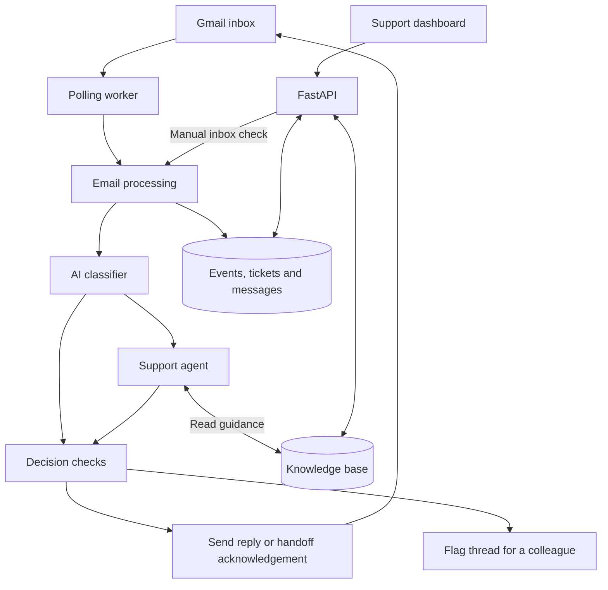
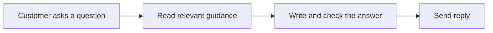
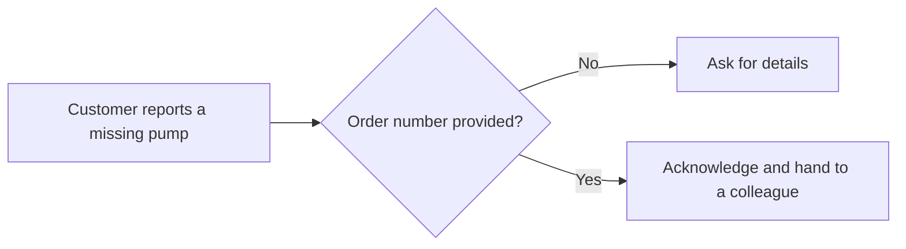
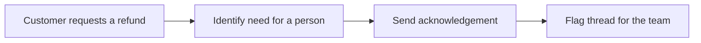
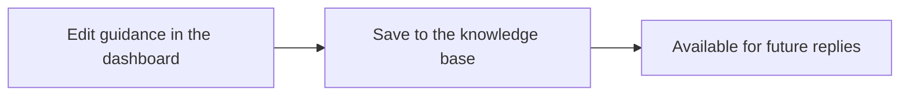

# AI Customer Support

An email support assistant for **Harbor & Pine**, a home and outdoor store selling on Amazon. It answers routine questions using company guidance and hands cases that need a person to the support team.

Customers continue using email. The team uses a dashboard to view conversations, check processing activity, and update the knowledge base.

## What it does

- Answers questions about paddle boards, shelving, returns, warranties, and shipping.
- Reads the email thread to understand the latest message and previous replies.
- Asks for missing details, such as an order number or damaged part number.
- Sends an acknowledgement and flags cases that need human attention.
- Records incoming messages, outgoing replies, and processing outcomes.

## Demo

### Customer emails

**Product advice** — A customer asks which paddle board suits a 90 kg rider.


**Troubleshooting** — A customer reporting air loss receives valve-check instructions and a request for follow-up details.


**Human handoff** — A refund request receives an acknowledgement that a colleague will reply.


### Support dashboard

**Tickets** — The team can read the conversation and see that the refund request has been escalated.


**Events** — Processing history shows each event’s status, attempts, and errors.


**Knowledge base** — The team can edit the guidance used by the assistant, including escalation rules.


## Architecture



The worker checks Gmail on a schedule. The classifier identifies the topic and whether a person is needed. Routine cases go to the support agent, which can read company guidance through tools. Python checks the resulting proposal before the application sends a response.

The knowledge base and support records live in Supabase Postgres. FastAPI serves the dashboard and its API; the polling worker runs as a separate process.

## AI concepts

- **Classification** — Assigns a topic and identifies cases that need human attention before drafting a detailed answer.
- **Tool calling** — The support agent uses `list_sections` and `get_section` to fetch guidance as needed.
- **Knowledge retrieval** — Retrieves complete topic sections from the database. The small, curated knowledge base uses section lookups rather than vector search.
- **Structured outputs** — Pydantic models define the fields returned by the classifier and agent, including the reply, issue details, and proposed decision.
- **Conversation context** — Each run receives the email thread, with quoted text reduced, to interpret follow-up messages.
- **Output checks** — A validator rejects empty replies and certain references to internal AI terminology. Decision checks also use the agent’s information and action flags.
- **Human handoff** — Python business rules determine product-specific next steps. Cases requiring a shipment, exchange, or replacement are handed to a colleague.

## Backend concepts

- **API and authentication** — FastAPI provides password-protected endpoints for tickets, events, knowledge edits, and manual inbox checks.
- **Gmail integration** — OAuth credentials allow the application to read threads, send replies, and apply labels.
- **Background processing** — A polling worker processes new emails at a configurable interval.
- **Persistence** — Four database tables store events, tickets, messages, and knowledge entries.
- **Processing tracking** — Unique Gmail message IDs identify previously claimed messages. Failed events can be retried, with a three-attempt cutoff in the processing flow.
- **Business rules** — Product policies are expressed in Python, such as choosing the next step for a leak or damaged shelf panels.
- **Docker deployment** — One image contains the backend and built dashboard. Docker Compose runs separate API and worker services.

## Workflows

### A routine question

“I weigh 90 kg. Which paddle board should I choose?”



### A product problem

“The pump was missing from my order.”



The proposed action is to ship the missing part. A colleague arranges the shipment.

### A human handoff

“I want my money back.”



The assistant leaves further messages to the team until the `needs-human` label is removed in Gmail.

### A knowledge update



## Evaluation

The evaluation dataset contains **18 example emails**, covering product questions, missing parts, leaks, returns, delivery enquiries, German-language input, and attempts to override the assistant’s instructions.

Each case checks two outcomes:

- **Category:** Did the system choose the expected knowledge section?
- **Action:** Did it choose the expected reply or escalation?

With the environment configured and knowledge base loaded, run:

```bash
uv run python -m evals.run_evals
```

This runs the decision pipeline with real model calls and knowledge-base access. It does not send emails. The report shows category and action results; it does not measure every factual claim, tone, or the complete Gmail workflow.

*Evaluation results: to be added after a recorded run.*

## Scope and limitations

- The current setup serves one support mailbox and one shared dashboard login.
- Guidance covers the products and policies in the six knowledge-base sections.
- Emails with attachments are escalated; attachments are not analysed.
- The assistant cannot look up Amazon orders, issue refunds, or arrange shipments.
- Classification and extracted issue details depend on model judgment. Output checks do not independently verify every statement against its source.
- The dashboard displays conversations and proposed actions. Human replies and handoff management happen in Gmail.

## Future potential

- Evaluate reply accuracy, language, and tone alongside routing decisions.
- Add source tracking so each answer can be checked against the guidance it used.
- Let support staff review drafts and manage handoffs from the dashboard.
- Connect authorised order and fulfilment systems for order-specific assistance.
- Extend knowledge retrieval as the product catalogue grows.

## Built with

Python · FastAPI · Pydantic AI · Anthropic models · Supabase Postgres · Gmail API · React · TypeScript · Tailwind CSS · shadcn/ui · Docker
